<p align="center">
  <a href="https://endiluong.github.io/zboard/"></a>
</p>

<p align="center">
  <a href="https://endiluong.github.io/zboard/">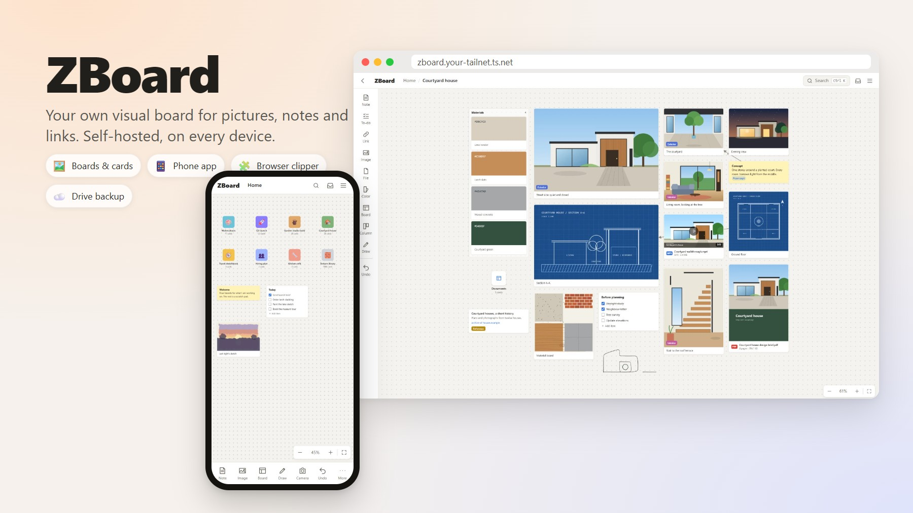</a>
</p>

<h1 align="center">ZBoard</h1>

<p align="center">
  <b>Your own visual board for pictures, notes, links, PDFs and videos.</b><br>
  A self-hosted, Milanote-style canvas that runs on your PC and follows you to your phone and tablet.
</p>

<p align="center">
  
  
  
  
  
  
</p>

<p align="center">
  <a href="https://endiluong.github.io/zboard/"><b>▶ Open the demo in your browser</b></a><br>
  <sub>It starts with an empty board, and everything you make stays in your own browser.</sub>
</p>

<p align="center">
  <a href="#-a-quick-tour">Tour</a> ·
  <a href="#-quick-start">Quick start</a> ·
  <a href="#-how-it-fits-together">How it works</a> ·
  <a href="#setup-on-windows-wsl2">Setup</a> ·
  <a href="#env-reference">.env</a> ·
  <a href="#phone-and-other-devices">Phone</a> ·
  <a href="#browser-extension">Extension</a> ·
  <a href="#cli">CLI</a> ·
  <a href="#backup-and-restore">Backups</a> ·
  <a href="#gotchas">Gotchas</a>
</p>

---

## ✨ Why ZBoard

<table>
  <tr><td width="34%">🖼️ <b>Boards full of pictures</b></td><td>Drop in images, notes, to-dos, links, colours and drawings, then arrange them freely. Boards go inside boards, as deep as you like.</td></tr>
  <tr><td>📄 <b>PDFs and videos too</b></td><td>A PDF shows its first page and opens in a reader that loads page by page. A video shows a frame and its length, and streams instead of downloading, even at 1–2 GB.</td></tr>
  <tr><td>📱 <b>On every screen</b></td><td>The same boards on your PC, phone and tablet, kept in sync live. On a phone it installs like an app, with touch gestures and a camera button.</td></tr>
  <tr><td>🧩 <b>Save from anywhere</b></td><td>The <b>ZBoard Clipper</b> extension puts a Save button on every picture on the web, and you pick the board right there.</td></tr>
  <tr><td>🔒 <b>Yours, at home</b></td><td>One Node process with SQLite on your own machine. No account, no cloud service, nothing shared.</td></tr>
  <tr><td>☁️ <b>Backed up properly</b></td><td>Daily backups to this PC and then your own Google Drive (encrypted if you want), plus zip export of any board.</td></tr>
  <tr><td>⚡ <b>Fast with thousands of cards</b></td><td>A 1,680-picture board still pans and zooms smoothly.</td></tr>
</table>

## 👀 A quick tour

### Your boards, at a glance
Each board gets an icon or emoji cover and shows how many cards it holds. Click one to go inside.

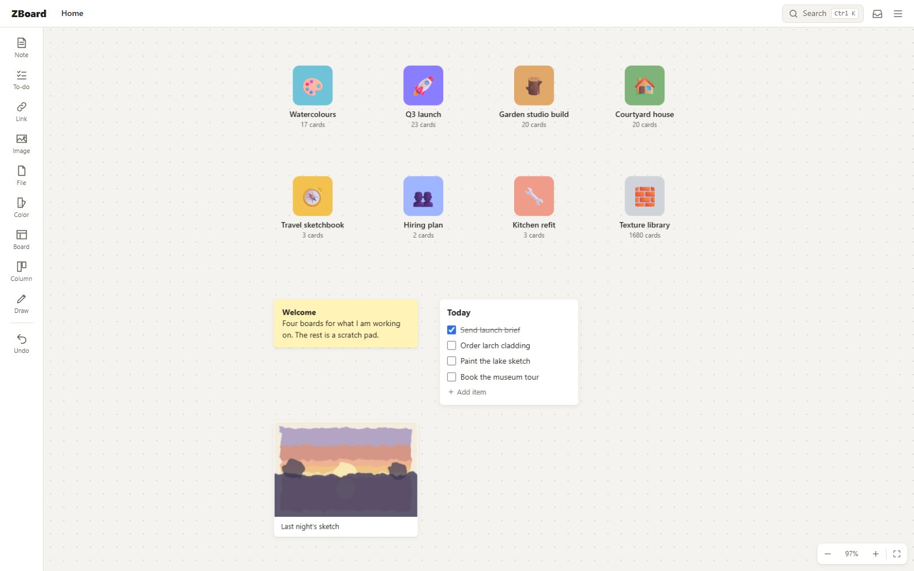

### A canvas for everything
Pictures, columns, YouTube links that play in place, colour swatches and notes, laid out however you think.

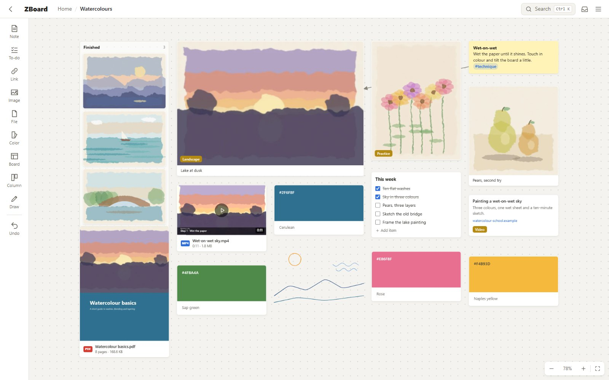

<table>
  <tr>
    <td width="50%">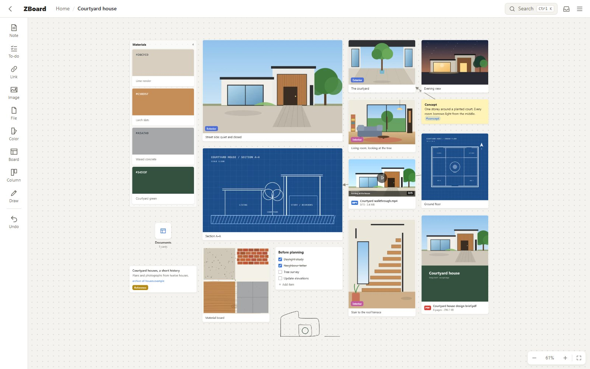</td>
    <td width="50%">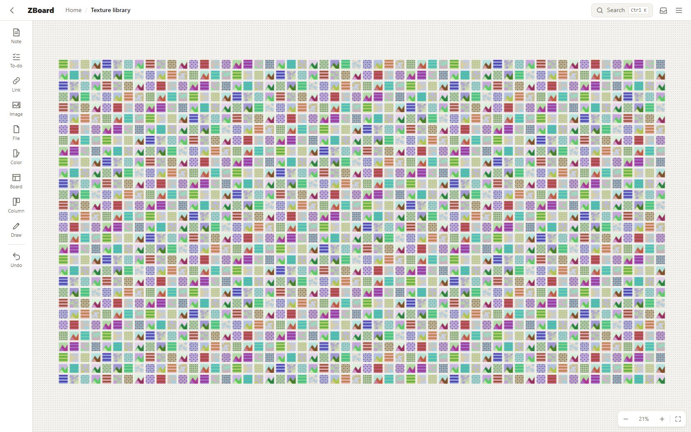</td>
  </tr>
  <tr>
    <td align="center"><sub>Reference photos and guides, side by side</sub></td>
    <td align="center"><sub>1,680 pictures on one board, still smooth</sub></td>
  </tr>
</table>

### Tools that follow your selection
Select a card and the toolbar switches to what you can do with it: draw on a picture, crop and rotate, caption, colour, labels and more. Click empty board (or **Done**) to switch back.

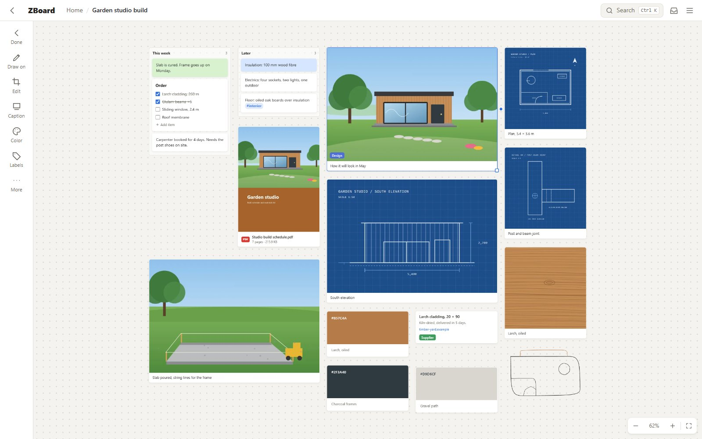

### PDFs and videos
Drop a PDF or a video on a board like a picture. A PDF card shows its first page and page count; a video card
shows a frame from it, a ▶ and its length. Big files go up in the background with a progress bar, and carry on
where they stopped if the page is closed or the connection drops.

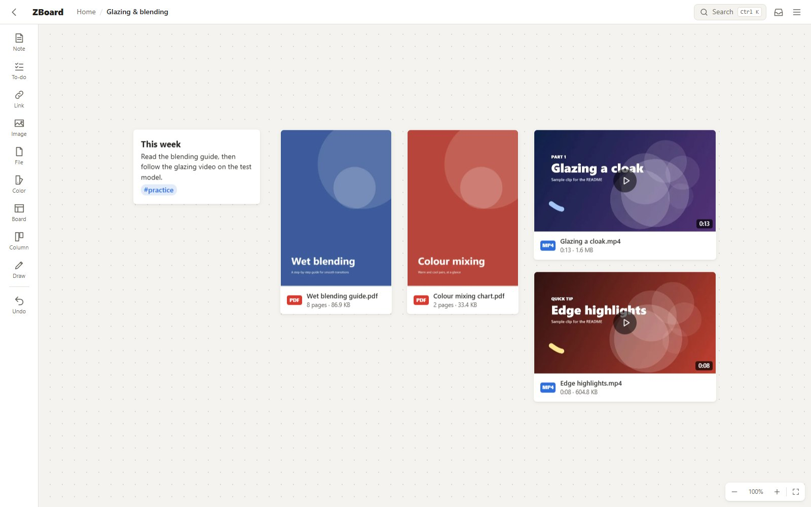

Open a PDF and it reads like a document: fit to width, zoom, jump to a page. It loads **page by page**: only the
parts of the file for the pages on screen are fetched, so a 100 MB PDF opens about as fast as a small one, and a
PDF you opened in the last 7 days opens again without downloading anything. Open a video and it plays full
screen, **streaming**: only the part being played is downloaded, and jumping ahead fetches just that part.

<table>
  <tr>
    <td width="40%">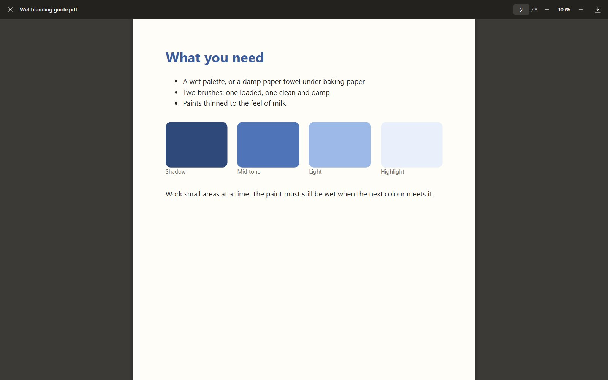</td>
    <td width="40%">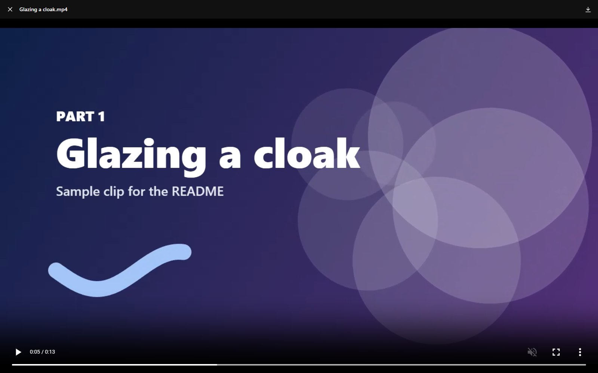</td>
    <td width="20%">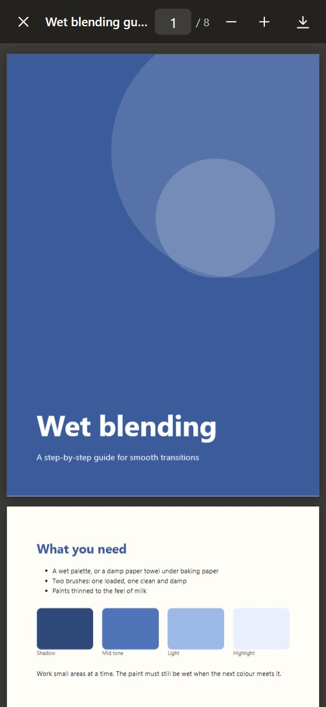</td>
  </tr>
  <tr>
    <td align="center"><sub>PDF reader</sub></td>
    <td align="center"><sub>Video player</sub></td>
    <td align="center"><sub>Reading on a phone</sub></td>
  </tr>
</table>

<sub>The files in these pictures were made for this README.</sub>

### Find anything with Ctrl+K
Search looks through every board, note, link and to-do, ignores accents, and understands `#tags` and labels.

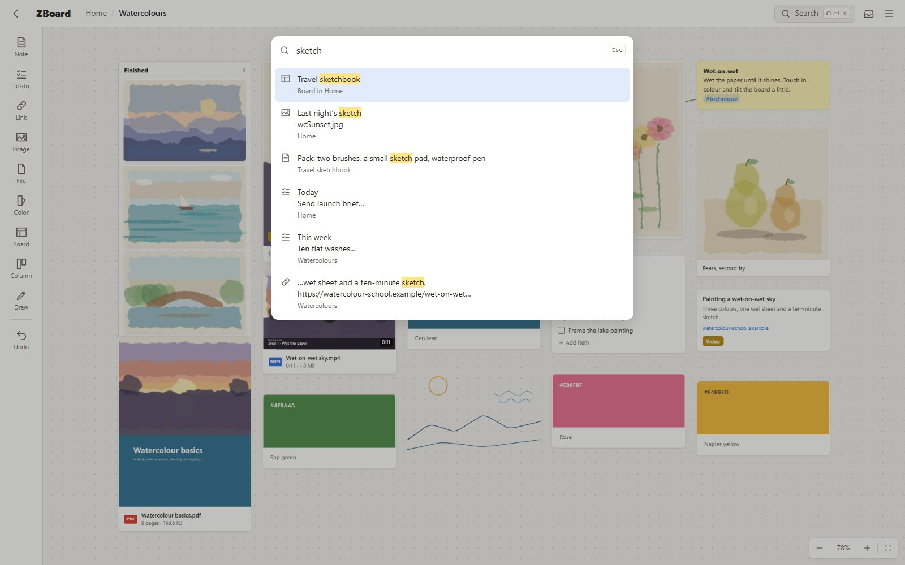

### Phone and tablet
Install it to your home screen and it opens like an app. One finger pans, two fingers zoom, hold a card to pick it up, and the camera button adds a photo straight to the board.

<table>
  <tr>
    <td width="27%">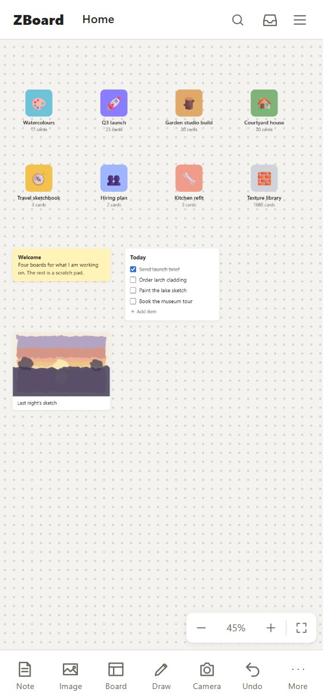</td>
    <td width="27%">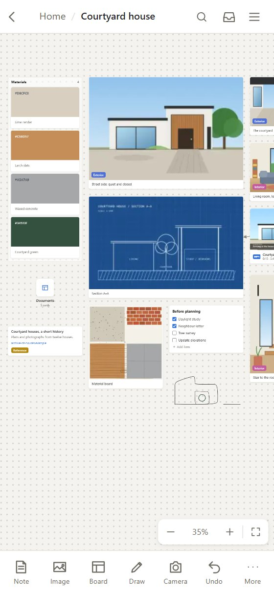</td>
    <td width="46%">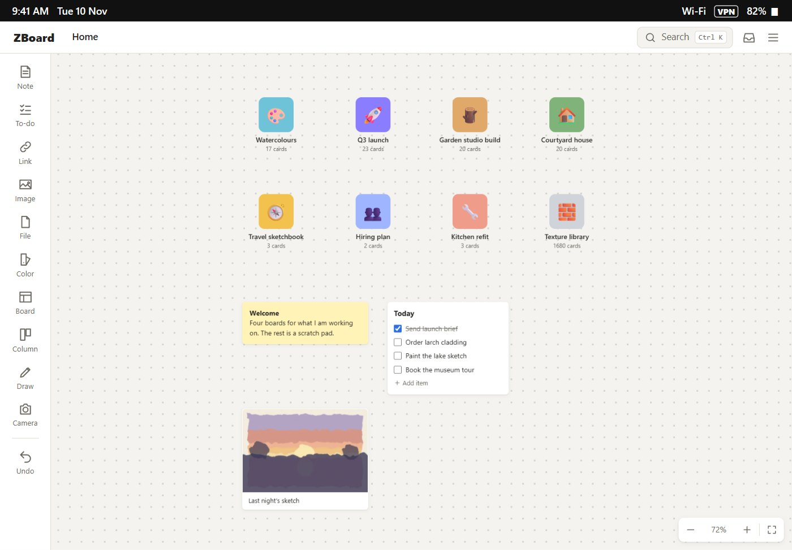</td>
  </tr>
  <tr>
    <td align="center"><sub>Phone: Home</sub></td>
    <td align="center"><sub>Phone: a board</sub></td>
    <td align="center"><sub>iPad</sub></td>
  </tr>
</table>

### Save from any web page
With **ZBoard Clipper**, hover a picture and click **Save** in its corner. Pick a board (type to search, Enter to save); the board you used last is at the top. Saved things wait in the board's **Saved items** panel until you drag them onto the canvas.

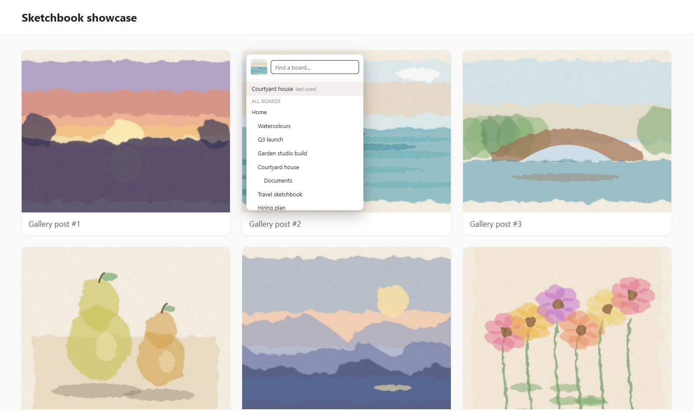

### Backups you can trust
Backups go to this PC first and then Google Drive. Pictures nothing uses any more are cleaned up only when every kept backup is newer, and the confirmation says exactly what goes and that it can't be undone.

<p align="center">
  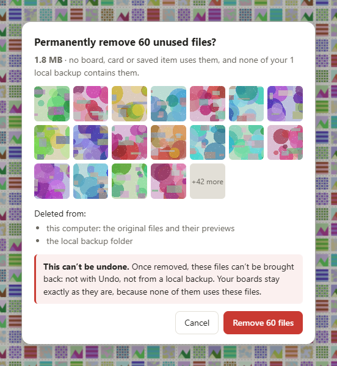
</p>

## 🚀 Quick start

```bash
git clone <your repo> ~/zboard && cd ~/zboard
./start.sh            # first run creates .env: set APP_PASSWORD in it, then run again
```

Open <http://localhost:3000> and log in. That's it. For your phone, see [Tailscale](#tailscale-https-and-access-from-anywhere);
for the browser extension, see [Browser extension](#browser-extension).

## 🧭 How it fits together

Every device reaches ZBoard the same way: over your private Tailscale network, with HTTPS. The server runs on
its own small machine at home (a mini PC, or WSL2 on a PC); nothing is exposed to the internet.

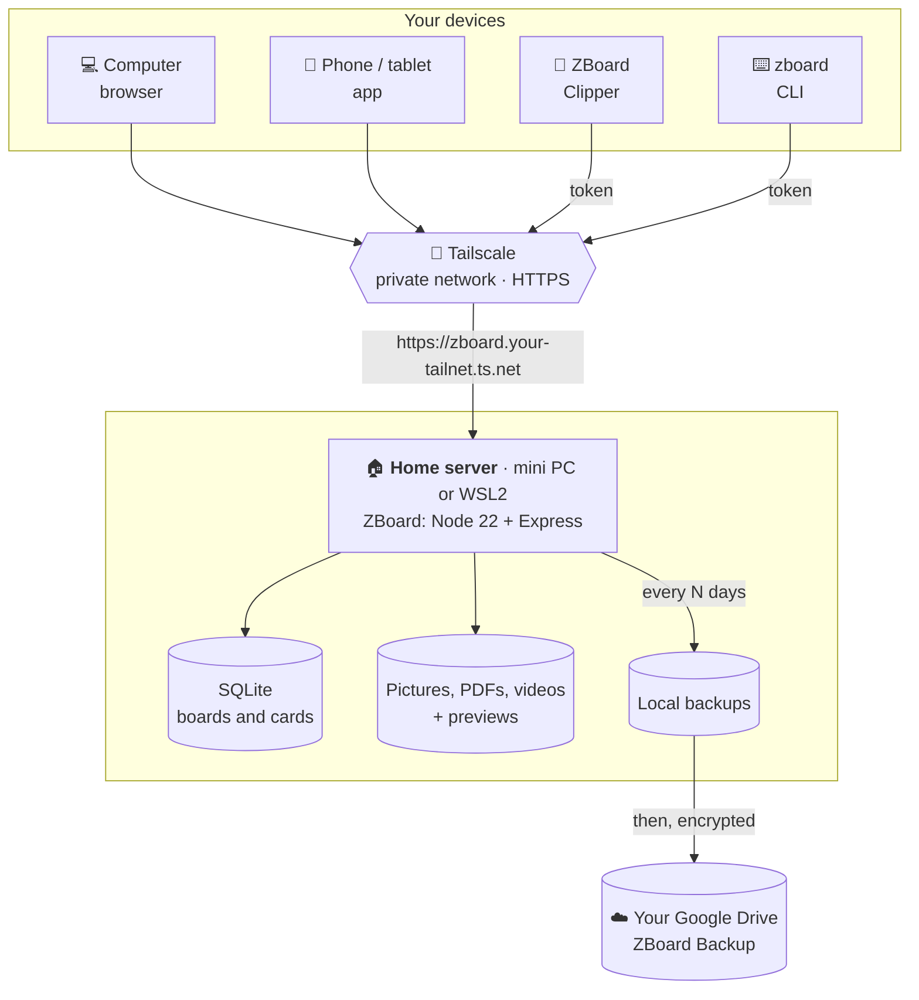

## 🧰 Everything it can do

- **Canvas**: notes, to-dos, images, links (YouTube plays in place), boards with icon covers, columns,
  drawings, styled arrows, colours, undo, live sync between devices.
- **Actions**: selecting a card flips the left toolbar (the bottom bar on a phone) to that card's actions;
  click empty board or Done to flip back. Images: Draw on, Edit (crop and rotate, kept on the card,
  the file is untouched), Caption, Color, Labels, More (open, download original, replace image,
  duplicate, copy, front/back, delete). Arrows: colour, start/end heads, label, dashed, weight.
- **Colours**: Color on any card sets a background (also behind see-through pictures) or a top strip,
  from swatches, recent colours or a custom colour. Color cards (left toolbar) hold one swatch with its
  hex code and a name; "Pick a colour…" in an image's More menu uses the browser's eyedropper (Chrome,
  Edge) and drops the picked colour beside the picture.
- **Zoom**: −, +, the zoom level (click for 100%) and Fit to screen (Shift+1) sit bottom right. Big
  boards stay smooth: the board moves as one GPU layer, and far out it is drawn as a single picture.
- **Labels**: coloured name chips on any card, picked or created from Labels. Search finds them, and each
  label is also a #tag; click a chip to see every card with it.
- **Draw**: the Draw tool (left toolbar) opens a drawing layer: pen (pressure with a stylus), select and
  move strokes, eraser, colours, four sizes, undo/redo (Ctrl+Z / Ctrl+Y), Save or Discard (Esc).
  Saved strokes become a drawing card where you drew them; double-click it to draw on it again. Keys in
  drawing mode: P pen, V select, E eraser, Delete removes selected strokes, Ctrl+S saves. Wheel and
  trackpad still pan and zoom.
- **PDFs**: the card shows page 1 (drawn once by the browser that adds it, then kept on the server) and the
  page count. The reader (react-pdf, downloaded only the first time a PDF is opened) fits the page to the
  screen, zooms, jumps to a page and draws only the pages near the screen. It reads the file in parts with
  range requests, each retried if it stalls, and keeps the parts it read in the browser for 7 days (500 MB
  at most). Browsers too old for the reader open the PDF in their own viewer.
- **Videos**: the card shows a frame, ▶ and the length. Playing uses the browser's own player (native
  controls and picture-in-picture on iPhone) and streams with range requests. MP4 (H.264) plays everywhere;
  an iPhone's HEVC video may not play in Chrome on Windows, and then it offers to open in a new window.
- **Uploads**: anything up to `MAX_UPLOAD_MB`. Files over 5 MB go up in checksummed 5 MB pieces that resume
  after a closed page or a lost connection, sending only what's missing. A failed upload shows a red card;
  tap it to choose the file again. Unfinished uploads are dropped after 7 days. Other files (ZIP, …) show
  their type and size and download when opened.
- **Phone**: touch gestures, camera button, installs from the home screen (PWA). Pictures show the card's
  colour while they load and retry by themselves on a weak connection; previews you've seen are kept on the
  device.
- **Find**: Ctrl+K search (accent-insensitive) and #tags.
- **Keep**: a full backup every few days (you choose, default daily) to a local folder and then Google Drive,
  Google Drive copies minutes after edits, zip export of any board.
- **Clip**: ZBoard Clipper for Chrome/Edge saves images, links and text into a board's Saved items.
- **Terminal**: `zboard` CLI, with images drawn inline over SSH.

---

# 📖 Documentation

## Setup on Windows (WSL2)

ZBoard runs inside WSL2 (Ubuntu) and is opened from Windows at <http://localhost:3000>.

1. Install WSL2 + Ubuntu (admin PowerShell): `wsl --install -d Ubuntu`, then reboot.
2. In Ubuntu, install Node 22.13+ and build tools:

   ```bash
   sudo apt update && sudo apt install -y build-essential python3 git
   curl -fsSL https://raw.githubusercontent.com/nvm-sh/nvm/v0.40.3/install.sh | bash
   source ~/.bashrc && nvm install 22
   ```

3. Get the code into the **Linux** filesystem (`~/zboard`, never `/mnt/c/...` or a OneDrive folder):

   ```bash
   git clone <your repo> ~/zboard && cd ~/zboard
   ```

4. Start it. The first run creates `.env`; set `APP_PASSWORD` in it and run again:

   ```bash
   ./start.sh
   ```

   `start.sh` checks Node, installs packages, builds the web app and starts the server on port 3000.
   Stop it with Ctrl+C.

**Native Windows instead of WSL** (no Docker or WSL needed, Node 22.13+ for Windows):
`powershell -ExecutionPolicy Bypass -File .\start.ps1`.

**Start at boot** (survives Windows Update reboots): in an *administrator* PowerShell run
`powershell -ExecutionPolicy Bypass -File scripts\windows\install-autostart.ps1`. It registers a
"ZBoard" scheduled task that runs `start.sh` in WSL at start-up, before anyone logs in. Also stop the PC
from sleeping while plugged in: `powercfg /change standby-timeout-ac 0`. (On native Windows, wrap
`start.ps1` with [NSSM](https://nssm.cc) as a service instead.)

**Linux or macOS**: install Node 22.13+, clone, `./start.sh`.

## .env reference

| Key | Default | Meaning |
| --- | --- | --- |
| `APP_PASSWORD` | – (required) | Password for the web app and `zboard login`. |
| `PORT` | `3000` | HTTP port. |
| `DATA_DIR` | `./data` | Database, originals (`files/`), thumbnails, the CLI token. Relative paths are from the repo root. |
| `BACKUP_DIR` | `./backup` | Where local backups go. Put it on a second disk. |
| `BACKUP_KEEP` | `14` | Local snapshots to keep. |
| `BACKUP_AUTO` | – | `off` stops the automatic full backup (only **Back up now** then). How often it runs is set in **Menu → Backup & Restore**. `BACKUP_CRON` is no longer used. |
| `CLEANUP_CRON` | `0 4 1 * *` | When unused files are checked (1st of each month, 04:00). A run missed while ZBoard was off happens at the next start. `off` disables it. |
| `CLEANUP_AFTER_DAYS` | `30` | A picture no card or saved item uses is removed (original, previews, local backup copy, Drive copy) once unused this long **and** older than every kept backup. |
| `MAX_UPLOAD_MB` | `50` | Largest upload, in MB. Files over 5 MB go up in resumable pieces, so videos of 1–2 GB work (set `2048`). The server needs about twice the file's size free while one finishes. |
| `GOOGLE_CLIENT_ID`, `GOOGLE_CLIENT_SECRET` | – | Google Drive backup, see below. |
| `GOOGLE_BACKUP_PASSPHRASE` | – | Optional: encrypt everything before it goes to Drive. Needed to restore. |

The server refuses to start without `APP_PASSWORD`. Sessions last 400 days; the API token used by the
extension and the CLI is shown (and can be replaced) in **Menu → Browser extension**.

## Phone and other devices

- **Same Wi-Fi**: open `http://<PC address>:3000`. With WSL2, Windows has to pass the port on: either turn on
  mirrored networking (create `%UserProfile%\.wslconfig` with `[wsl2]` and `networkingMode=mirrored`, then
  `wsl --shutdown`), or forward it once in an admin PowerShell:
  `netsh interface portproxy add v4tov4 listenport=3000 connectport=3000 connectaddress=$(wsl hostname -I)`.
  Then allow it through the firewall on private networks:
  `New-NetFirewallRule -DisplayName ZBoard -Direction Inbound -Protocol TCP -LocalPort 3000 -Action Allow -Profile Private`.
- **Install as an app and use the camera**: browsers only allow this over HTTPS, so use Tailscale (next section),
  open the `https://….ts.net` address, sign in, then *Share → Add to Home Screen* (iPhone, in Safari, Chrome or
  Edge) or *Install app* (Android).
- Touch: one finger pans, two fingers zoom, hold a card to pick it up, double-tap to open or edit, hold empty
  space for the add menu. In **Saved items**, hold an item and drag it onto the board.

## Tailscale: HTTPS and access from anywhere

1. Install Tailscale on Windows and on the phone, sign in to the same account.
2. In the Tailscale admin console, enable **MagicDNS** and **HTTPS certificates**.
3. On Windows (with ZBoard running): `tailscale serve --bg 3000`. From a WSL terminal that is
   `"/mnt/c/Program Files/Tailscale/tailscale.exe" serve --bg 3000`.
   ZBoard is now at `https://<pc-name>.<tailnet>.ts.net` for your devices only.
4. On the phone (even on mobile data): open that address, log in, install to the home screen.

After renaming the PC or the tailnet in the admin console, run `tailscale serve reset` and
`tailscale serve --bg 3000` again, and open the new address once on the PC so the certificate is issued
(about 30–40 seconds) before the phone uses it.

**Remote shell for the CLI**: Tailscale's SSH server isn't available on Windows. Use Windows' own
OpenSSH Server (Settings → System → Optional features → OpenSSH Server, then `wsl` after connecting), or run
`sshd` inside WSL. Over SSH, `zboard view` draws images in the terminal.

## Browser extension

**Menu → Browser extension → Set up ZBoard Clipper**:

1. *Download the extension* and unzip it.
2. Open `edge://extensions` (or `chrome://extensions`), turn on **Developer mode**, **Load unpacked**, pick the folder.
3. Click the ZBoard Clipper icon and paste the server address and token shown in the menu.

Then hover any image and click the **Save** button in its corner: pick a board (type to search, Enter saves;
the last board used is at the top). Or right-click an image, link, selection or page → **Save to ZBoard** →
your default board or any board in the tree. The hover button can be switched off in the popup. The popup can
save the page link or pick several images at once. Saved things wait in the board's **Saved items** panel
(inbox icon in the top bar); drag them onto the canvas.
If you press **New token**, the extension says so and asks you to reconnect.

After updating the extension's files, press ↻ on its card in `chrome://extensions` (Chrome loads it from the
folder you picked in step 2, so update that folder).

## CLI

```bash
./install-cli.sh          # puts "zboard" on your PATH (WSL/Linux/macOS)
zboard                    # interactive shell with Tab completion and history
zboard "cd Minis; ls"     # one-shot
zboard < script.txt       # one command per line
```

On native Windows: `npm link` inside `cli\` (or put `cli\` on PATH and use `zboard.cmd`).

With no setup it connects through the token file the server writes. Order:
`ZBOARD_URL` + `ZBOARD_TOKEN` → `~/.config/zboard/config.json` (from `zboard login`) → `$DATA_DIR/cli-token`
→ `<repo>/data/cli-token` → `/data/cli-token` (Docker).

| | |
| --- | --- |
| Move around | `ls [-l]`, `cd <name\|number\|..\|/\|-\|/Home/a/b>`, `tree`, `pwd`, or just type a board name |
| Read | `cat`/`view <card>`, `info`, `get` (downloads the original), `open`, `search <words\|#tag>`, `tags`, `saved` |
| Write | `new note\|todo\|link\|board\|column [text] [--in <column>]`, `edit` (in `$EDITOR`), `rename`, `check`/`uncheck`, `upload`, `rm`, `mv`, `cp` |
| Account | `login`, `logout`, `whoami` |

Cards are referred to by their number in `ls` or by the start of their title; names with spaces work without
quotes (`mv Paint list /Paint ideas`). Notes are edited as markdown-ish text (`**bold**`, `*italic*`,
`~~strike~~`, `_underline_`, `# heading`, `- bullet`, `[text](url)`). Without `$EDITOR`: nano, then vi
(Windows: Notepad, then `code --wait`). Images open in the desktop viewer (`wslview` in WSL) or, over SSH,
draw inline: iTerm2/WezTerm and kitty/Ghostty natively, other terminals (and anything inside tmux or Windows
Terminal) as truecolor half-blocks.

## Google Drive backup (one-time setup)

ZBoard backs up to your own Google Drive with your own Google Cloud project, so no third party sees the data.
It only uses the `drive.file` scope: it can see the files it created (the `ZBoard Backup` folder) and nothing else.

1. Go to <https://console.cloud.google.com/>, create a project (e.g. "ZBoard").
2. **APIs & Services → Library** → enable **Google Drive API**.
3. **APIs & Services → OAuth consent screen**: User type **External**, fill in the app name and your email.
   Add the scope `.../auth/drive.file`. Add yourself as a test user.
4. **Publish the app** (OAuth consent screen → *Publishing status* → **In production**).
   While it is in *Testing*, Google expires the sign-in after 7 days and backups stop.
   An unverified app in production is fine for personal use: Google shows a warning screen once when you connect.
5. **APIs & Services → Credentials → Create credentials → OAuth client ID**, application type
   **TVs and Limited Input devices**. Copy the client ID and secret.
6. Put them in `.env` (`GOOGLE_CLIENT_ID`, `GOOGLE_CLIENT_SECRET`, optional `GOOGLE_BACKUP_PASSPHRASE`) and restart.
7. In ZBoard open **Menu → Backup & Restore → Connect Google Drive**. Open the address shown
   (google.com/device) on any device, enter the code and approve.

What happens then:

- Each original image is uploaded once into `ZBoard Backup/files/`.
- A database snapshot is uploaded to `ZBoard Backup/snapshots/` 1–2 minutes after edits stop, and with every
  full backup (the same snapshot the local backup just saved). The last 30 snapshots are kept.
- **Restore** (Menu → Backup & Restore → Restore from Drive) downloads the newest snapshot and every original it needs and
  replaces this server's data. To move to a new machine: start ZBoard with an empty `data/`, connect the same
  Google account, press Restore. An empty server never uploads a snapshot by itself, so it can't overwrite your backup.

## Backup and restore

- **Full backup, every N days** (**Menu → Backup & Restore → Back up every**, 1–30 days, default 1): first a
  consistent snapshot of the database (`VACUUM INTO`) in `BACKUP_DIR/db/`, the last `BACKUP_KEEP` kept, plus a
  copy of every new original image in `BACKUP_DIR/files/`; then, if Google Drive is connected, that same snapshot
  and any new originals go to Drive. ZBoard checks at start-up and every hour whether one is due, so a backup
  missed while the PC was off runs as soon as ZBoard is up again. A failed local part doesn't stop the Drive part.
  **Back up now** runs one immediately.
- **Restore from a local backup**: stop ZBoard, then

  ```bash
  cp backup/db/zboard-<date>.db data/zboard.db && rm -f data/zboard.db-wal data/zboard.db-shm
  cp -n backup/files/* data/files/
  ./start.sh
  ```

  Thumbnails are rebuilt on start-up.
- **Restore from Google Drive**: see above.
- **Unused files**: deleting a card keeps its picture or file (undo and older backups may need it). A monthly
  check (`CLEANUP_CRON`) removes it everywhere (original, previews, local backup, Google Drive) once
  nothing has used it for `CLEANUP_AFTER_DAYS` and every kept backup is newer than that, so a backup you can
  still restore never misses a file. **Menu → Backup & Restore → Unused files** shows what is waiting, runs the check now, and **Clean up now…** removes them at once after reading every kept backup.
- **Export**: Menu → Export gives a zip of a board (or everything) with a `board.json` and the original files.

## Docker

```bash
cp .env.example .env      # set APP_PASSWORD
docker compose up -d --build
docker exec -it zboard zboard ls    # the CLI is inside the image
```

Data and backups are in named volumes (`zboard-data`, `zboard-backup`). On Docker Desktop keep it that way:
bind-mounting a `C:\` folder is slow and breaks SQLite locking. On Linux, set `DATA_PATH` and `BACKUP_PATH`
in `.env` to real disk folders (owned by uid 1000, the container's `node` user).

## Moving to the Linux mini PC

1. Mount the data and backup disks; set `DATA_PATH` and `BACKUP_PATH` in `.env`.
2. `docker compose up -d --build`
3. `tailscale serve --bg 3000` and `sudo tailscale up --ssh`
4. Install the PWA on the phone from the new ts.net address; update the extension's server address
   (the token moves with the data).
5. Bring the data over: Google Drive restore onto the empty server, or copy `data/` while both servers are stopped.

## Development

```bash
cd server && npm install && APP_PASSWORD=dev npm start      # API on :3000
cd web && npm install && npm run dev                          # Vite on :5173, proxies /api and /files
```

Checks:

- `cd server && npm test`: API checks with curl on a throwaway data dir (port 3999).
- `e2e/`: headless browser checks with an installed Edge (`npm install` in `e2e/`, run from Windows),
  against a server started with `APP_PASSWORD=testpw` and an empty data dir: `node e2e/step2.mjs` … `step26.mjs`;
  `step4` also needs `e2e/mock-google.mjs`. `bash e2e/step8.sh` checks the CLI.
- **Online demo** (`web/demo/`): `node demo/build.mjs` (in `web/`) builds the app into `web/dist-demo` with
  `server/src/db.js` running in a service worker on SQLite compiled to WebAssembly. Each visitor's boards and
  pictures stay in their own browser (IndexedDB). `node demo/test.mjs` checks that in-browser server, and
  `node e2e/step27-demo.mjs` checks the built demo in a browser. `.github/workflows/pages.yml` publishes it to
  GitHub Pages on every push to `main`.
- `./stress-test.sh 1000` makes a 1000-image board from your uploaded images; `./stress-test.sh --cleanup` removes it.

The screenshots in this README live in `docs/screenshots/`.

## Gotchas

- Work in the WSL filesystem (`~/zboard`), never under `/mnt/c` or a synced folder: slow, and SQLite locking breaks.
- Add the data folder to Windows Defender exclusions (`\\wsl$\Ubuntu\home\<you>\zboard\data`) so scans don't slow uploads.
- If port 3000 won't open, Windows may have reserved it: `netsh int ipv4 show excludedportrange protocol=tcp`.
- Express only serves a web build that exists at start-up: run `npm run build` in `web/` *before* restarting.
- Stop any old server before testing; a stale one on port 3000 serves old data. A second server on the same
  port exits with "Port 3000 is already in use".
- iPhone HEIC photos: the bundled image library can't decode HEIC and says so. Set the camera to
  **Most Compatible** (JPEG), or convert first.
- Google Drive stops after 7 days if the OAuth app is left in *Testing*: publish it.
- After **New token**, reconnect the extension and run `zboard login` (or rely on the token file).
- The phone app updates itself: a new build is picked up on the next load (close and reopen the home-screen app).
- `node:sqlite` needs Node 22.13+. Never install `better-sqlite3`.
